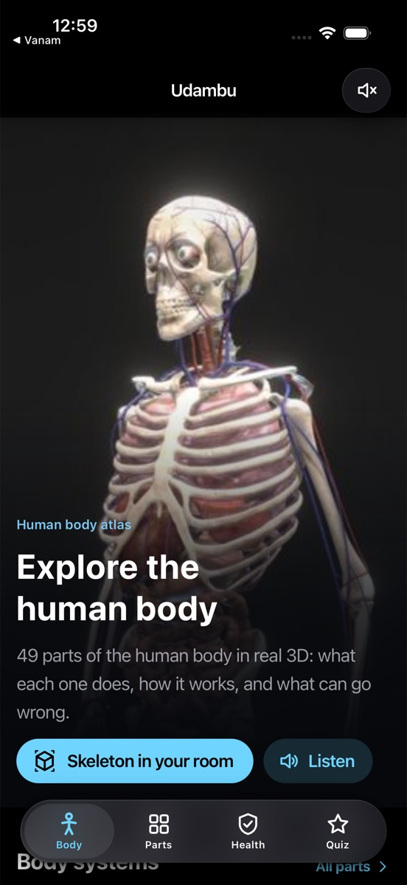
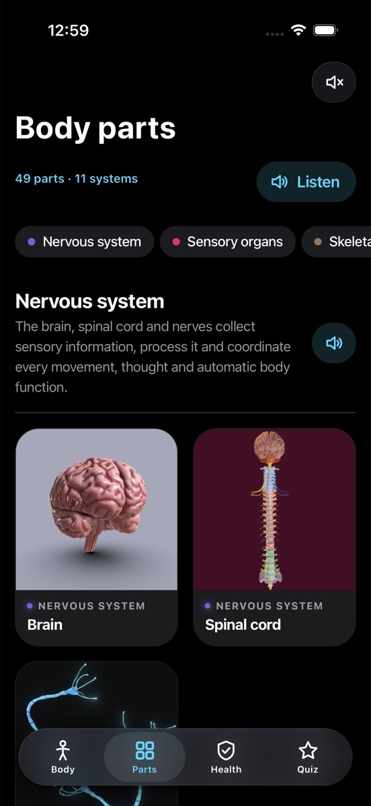
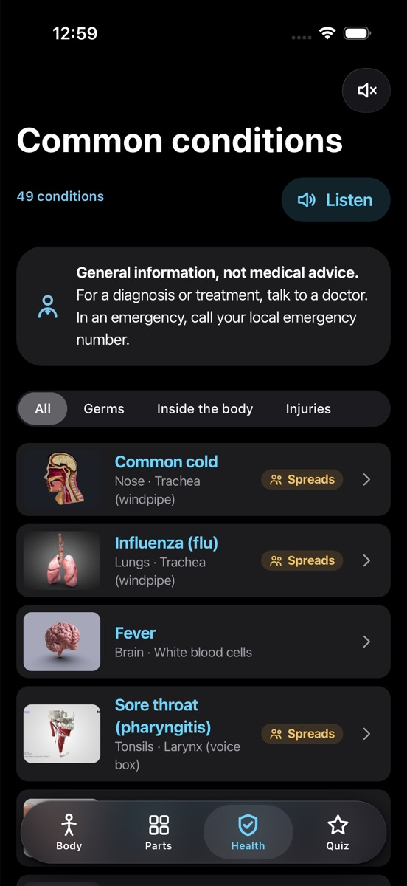
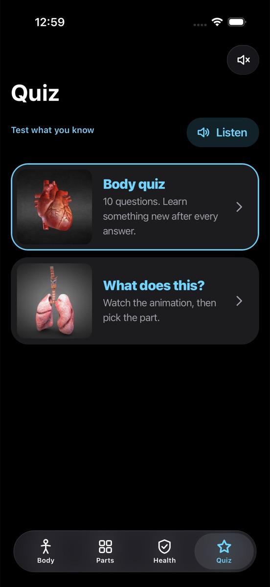
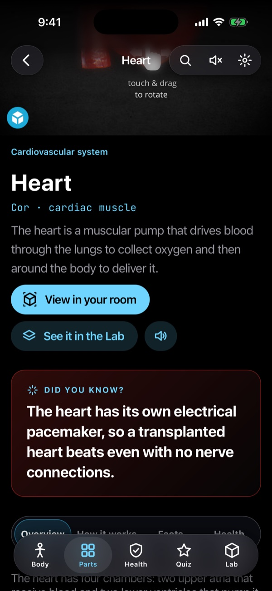
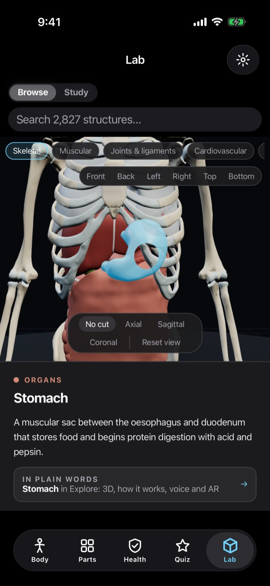

# Udambu for iPhone

A native SwiftUI shell (WKWebView, iOS 17+) around the Udambu web app, with the web files bundled inside the app
so everything except the live 3D models works offline. Inside this app the page switches to Apple's Human Interface
Guidelines look from the [Kolam iOS kit](https://github.com/tgopinath/kolam-design-system/tree/main/ios) (large titles,
Liquid Glass tab bar, back + centred title, haptics); in Safari or any other browser it keeps its Kolam look.
"View in your room" opens AR Quick Look natively with the USDZ model shipped in the app.
The app carries both levels of Udambu: Explore (plain words, 3D, voice, AR) and the Lab (the 2,827-structure 3D atlas,
an ES-module app that loads its models with fetch; the web view allows file access between the bundled files for it).
Web app source: https://github.com/tgopinath/udambu · live web app: https://udambu.vercel.app

     

## Run it

Clone next to the web app (`../udambu`), then:

```sh
sh sync-web.sh   # builds ../udambu (Explore + Lab), copies its dist/ into web/ and builds for the iPhone 17 Pro simulator
xcrun simctl install booted build/Build/Products/Debug-iphonesimulator/Udambu.app
xcrun simctl launch booted com.gopinath.Udambu
```

Debug builds accept `-KolamStartURL "#/parts"` (a route) and `-js "<line>"` on `simctl launch`.
Installing on other people's iPhones needs TestFlight or the App Store (Apple Developer Program).
